#  Demo Spring Data JPA — Gestion de produits

Application **Spring Boot** qui illustre l'accès aux bases de données relationnelles avec **JPA / Hibernate / Spring Data**, et expose une **API REST** documentée avec **Swagger (OpenAPI)**.

> 📌 **Convention pour les captures d'écran** : chaque bloc `📸 Capture` ci-dessous correspond à une image à placer dans `docs/images/` avec le nom indiqué. Remplacez simplement la ligne `![...]` par votre capture (ou gardez le même nom de fichier).

---

## 📑 Sommaire

1. [Objectifs](#1--objectifs)
2. [Architecture](#2--architecture)
3. [Technologies utilisées](#3--technologies-utilisées)
4. [Structure du projet](#4--structure-du-projet)
5. [Étape 1 : Installer IntelliJ IDEA Ultimate](#5--étape-1--installer-intellij-idea-ultimate)
6. [Étape 2 : Créer le projet Spring Boot](#6--étape-2--créer-le-projet-spring-boot)
7. [Étape 3 : Créer l'entité JPA `Product`](#7--étape-3--créer-lentité-jpa-product)
8. [Étape 4 : Configurer l'unité de persistance](#8--étape-4--configurer-lunité-de-persistance)
9. [Étape 5 : Créer l'interface `ProductRepository`](#9--étape-5--créer-linterface-productrepository)
10. [Étape 6 : Tester au démarrage (`CommandLineRunner`)](#10--étape-6--tester-au-démarrage-commandlinerunner)
11. [Étape 7 : Créer le contrôleur REST](#11--étape-7--créer-le-contrôleur-rest)
12. [Étape 8 : Documentation Swagger](#12--étape-8--documentation-swagger)
13. [Étape 9 : Tester les opérations](#13--étape-9--tester-les-opérations)
14. [Tester avec Postman](#14--tester-avec-postman)
15. [Lancer le projet](#15--lancer-le-projet)
16. [Basculer vers MySQL](#16--basculer-vers-mysql-optionnel)
17. [Conclusion](#17--conclusion)

---

## 1. 🎯 Objectifs

- Comprendre l'architecture **JDBC → Hibernate → JPA → Spring Data**.
- Créer une **entité JPA** et la mapper à une table (mapping objet-relationnel).
- Utiliser **Spring Data JPA** : on déclare une interface, Spring fournit l'implémentation.
- Exposer un **web service RESTful** (CRUD complet).
- Générer et utiliser la **documentation Swagger / OpenAPI**.
- Tester avec **Swagger UI**, la **console H2** et **Postman**.

---

## 2. 🏗️ Architecture

```
 Client (Swagger UI / Postman / Navigateur)
              │  HTTP (JSON)
              ▼
   ┌──────────────────────────┐
   │  ProductRestController   │   ← couche web (Spring MVC)
   └────────────┬─────────────┘
                ▼
   ┌──────────────────────────┐
   │   ProductRepository      │   ← Spring Data JPA (interface)
   └────────────┬─────────────┘
                ▼
   ┌──────────────────────────┐
   │   JPA  +  Hibernate      │   ← mapping objet-relationnel
   └────────────┬─────────────┘
                ▼
   ┌──────────────────────────┐
   │          JDBC            │
   └────────────┬─────────────┘
                ▼
        Base de données H2
```


## 3. 🧰 Technologies utilisées

| Technologie | Rôle |
|---|---|
| Java 21 | Langage |
| Spring Boot 3.5.13 | Framework (inversion de contrôle) |
| Spring Data JPA | Accès aux données (interfaces déclaratives) |
| Hibernate | Implémentation de la spécification JPA |
| H2 Database | Base de données en mémoire |
| Spring Web (MVC) | API REST |
| Lombok | Génération de getters/setters/constructeurs/builder |
| springdoc-openapi | Documentation Swagger |
| Maven | Gestion des dépendances |
| IntelliJ IDEA Ultimate | IDE |

---

## 4. 📂 Structure du projet

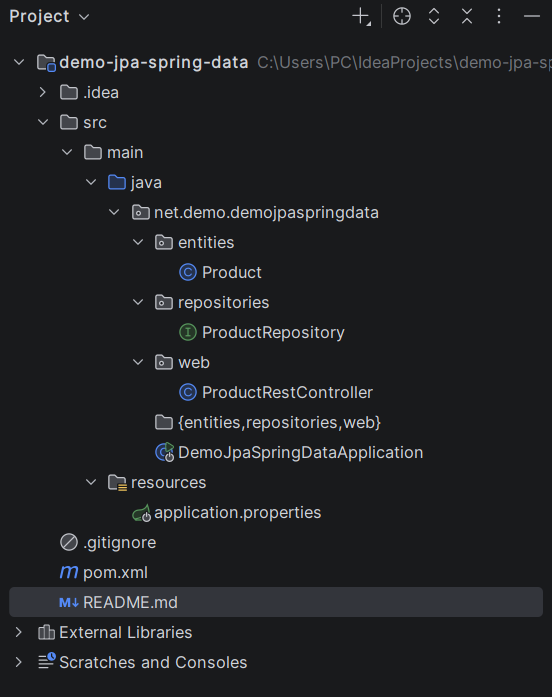


## 5. 🧱 Créer l'entité JPA `Product`

Fichier : `entities/Product.java`

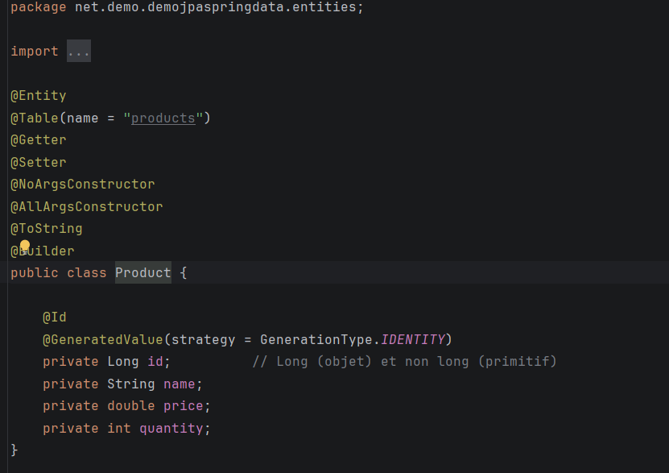

**Explications :**

| Annotation | Rôle |
|---|---|
| `@Entity` | La classe correspond à une table de la base |
| `@Table(name="products")` | Nom de la table (optionnel, sinon = nom de la classe) |
| `@Id` | Clé primaire |
| `@GeneratedValue(IDENTITY)` | Valeur générée automatiquement (auto-increment) |
| `@Getter` / `@Setter` | Lombok : génère getters et setters |
| `@NoArgsConstructor` / `@AllArgsConstructor` | Constructeurs sans / avec tous les paramètres |
| `@ToString` | Génère `toString()` |
| `@Builder` | Ajoute le **pattern Builder** |

> 💡 On utilise `Long` (objet) et non `long` (primitif) pour l'identifiant : un objet peut valoir `null` avant l'enregistrement.

---

## 6. ⚙️ Configurer l'unité de persistance

Fichier : `src/main/resources/application.properties`

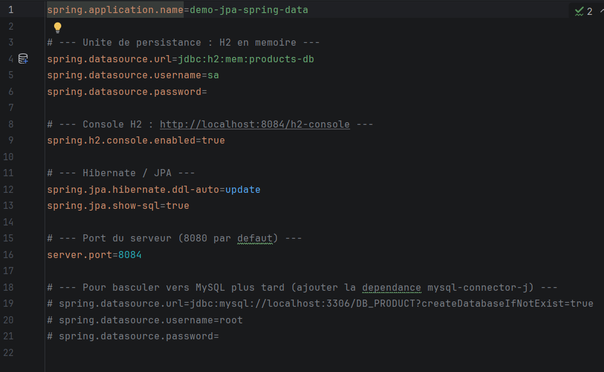

- `jdbc:h2:mem:products-db` → base **en mémoire** nommée `products-db` (attention à écrire `mem` correctement).
- `h2.console.enabled=true` → interface web pour consulter la base.
- `server.port=8084` → utile si le port 8080 est déjà occupé.

---

## 7. 📦 Créer l'interface `ProductRepository`

Fichier : `repositories/ProductRepository.java`

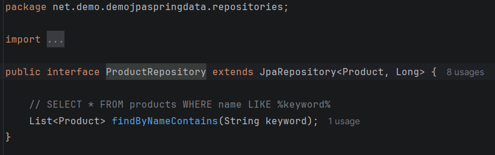

- `JpaRepository<Product, Long>` : 1er type = **entité gérée**, 2e type = **type de l'ID**.
- On hérite sans rien écrire de : `save()`, `findAll()`, `findById()`, `deleteById()`, etc.
- `findByNameContains(String keyword)` est une **méthode dérivée** : Spring la comprend à partir de son nom et génère :

```sql
SELECT * FROM products WHERE name LIKE '%keyword%'
```

---

## 8. 🧪 Tester au démarrage (`CommandLineRunner`)

Fichier : `DemoJpaSpringDataApplication.java`

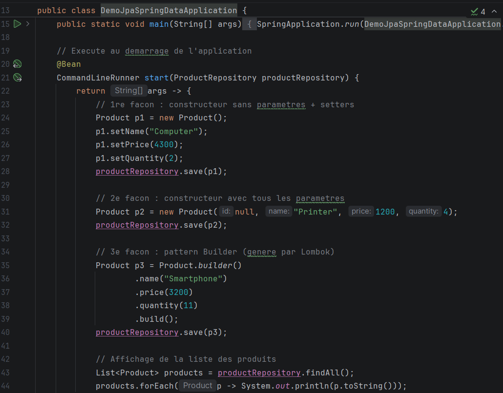

Les **3 façons de créer un objet** :

| Façon | Avantage / Inconvénient |
|---|---|
| `new Product()` + setters | Simple mais verbeux |
| `new Product(null, "Printer", ...)` | Peu pratique : il faut connaître l'ordre des paramètres, et mettre `null` pour l'ID |
| `Product.builder()...build()` | ✅ Le plus lisible (on voit chaque attribut) |


### Consulter la base avec la console H2

1. Ouvrir <http://localhost:8084/h2-console>

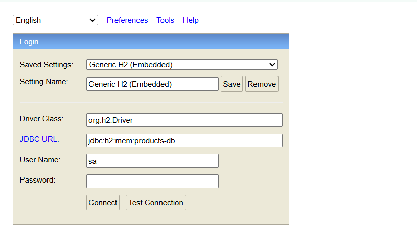

2. **JDBC URL** : `jdbc:h2:mem:products-db` (identique à `application.properties`)
3. User : `sa`, mot de passe vide → **Connect**
4. Exécuter : `SELECT * FROM PRODUCTS;`

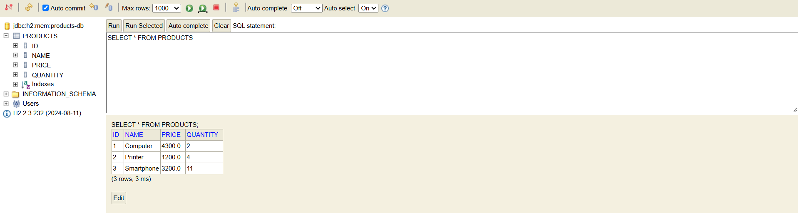

## 9. 🌐 Créer le contrôleur REST

Fichier : `web/ProductRestController.java`

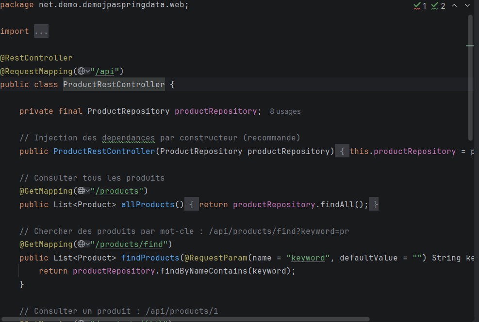
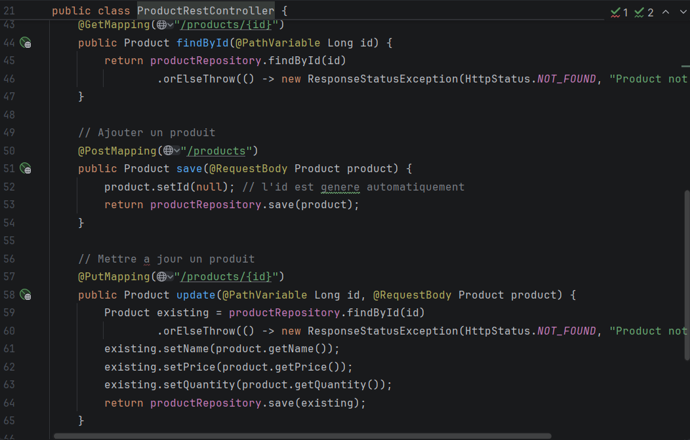
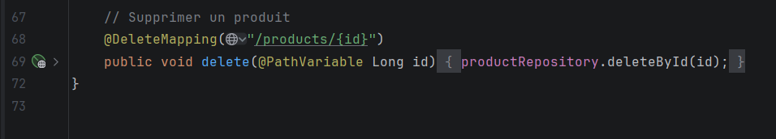

### Récapitulatif des endpoints

| Opération | Méthode HTTP | URL | Corps |
|---|---|---|---|
| Consulter tous les produits | `GET` | `/api/products` | — |
| Consulter un produit | `GET` | `/api/products/{id}` | — |
| Chercher des produits | `GET` | `/api/products/find?keyword=pr` | — |
| Ajouter un produit | `POST` | `/api/products` | JSON |
| Mettre à jour un produit | `PUT` | `/api/products/{id}` | JSON |
| Supprimer un produit | `DELETE` | `/api/products/{id}` | — |

### Notions importantes

- **`@RestController`** : les retours sont automatiquement **sérialisés en JSON**.
- **`@PathVariable`** : récupère une valeur **dans le chemin** (`/products/1`).
- **`@RequestParam`** : récupère un **paramètre de requête** (`?keyword=pr`), avec une valeur par défaut possible.
- **`@RequestBody`** : récupère les données **JSON du corps** de la requête.
- **`@RequestMapping("/api")`** : préfixe commun à tous les endpoints du contrôleur.
- **Injection par constructeur** : recommandée plutôt que `@Autowired` sur un attribut.

---

## 10. 📖 Documentation Swagger

Ajouter la dépendance dans `pom.xml` :

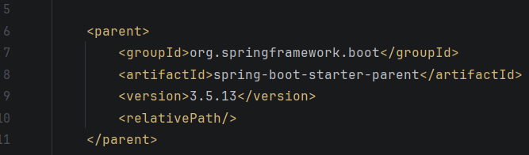

Recharger Maven (*Maven → Reload project*), redémarrer, puis ouvrir :

- **Swagger UI** : <http://localhost:8084/swagger-ui.html>
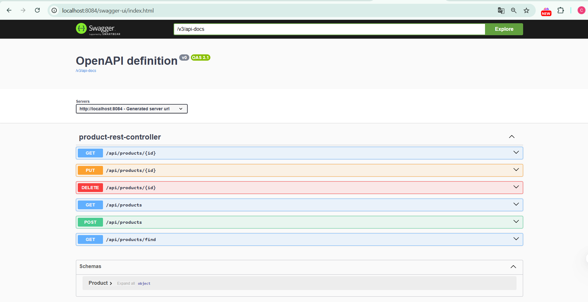
- **Description OpenAPI (JSON)** : <http://localhost:8084/v3/api-docs>
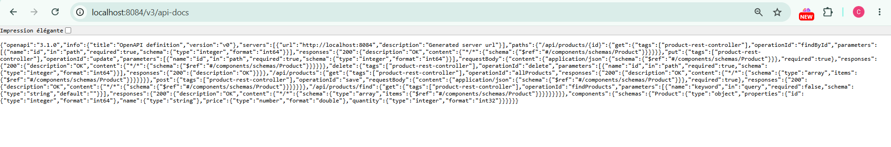

> 💡 La documentation Swagger/OpenAPI est l'équivalent du **WSDL** pour les web services SOAP : elle décrit l'interface du web service REST.


## 11. ✅  Tester les opérations

Toutes les opérations peuvent être testées via **Swagger UI** (bouton **Try it out → Execute**).

### ➕ Ajouter un produit — `POST /api/products`

Corps de la requête (sans `id`, il est généré) :

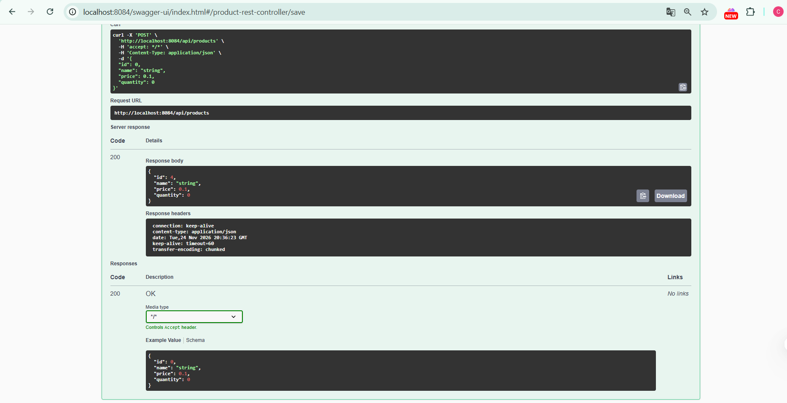


### 📋 Consulter tous les produits — `GET /api/products`

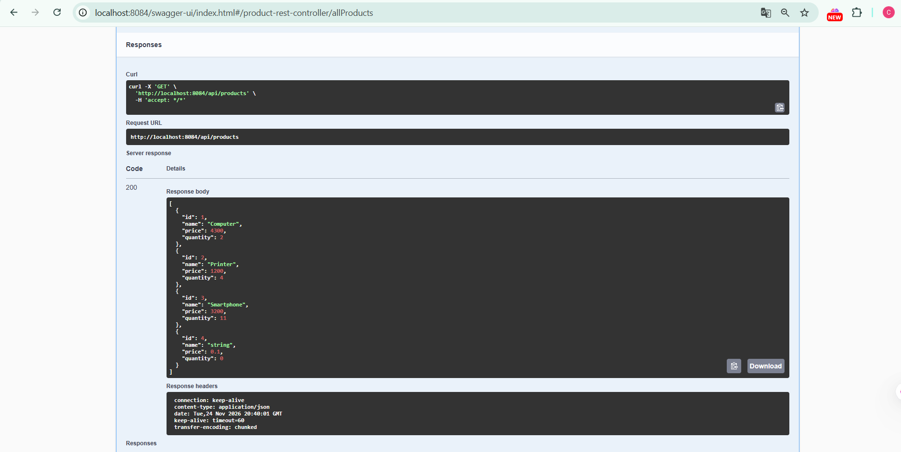

### 🔎 De la meme facon les autres catégorie

## 15. 🏁 Conclusion

Dans ce projet, nous avons :

- ✅ créé une **entité JPA** (`Product`) ;
- ✅ créé un **repository Spring Data** sans écrire d'implémentation ;
- ✅ configuré le **data source H2** ;
- ✅ créé un **contrôleur REST** avec le CRUD complet ;
- ✅ généré la **documentation Swagger/OpenAPI** ;
- ✅ testé le web service avec **Swagger UI**, la **console H2** et **Postman**.

Ce projet constitue déjà un **microservice** de base, qui servira de point de départ pour les prochains TP.
